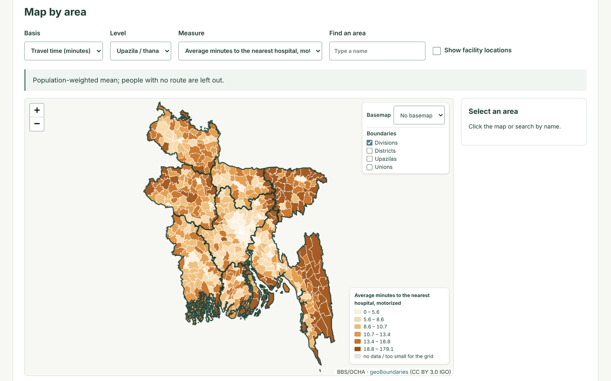
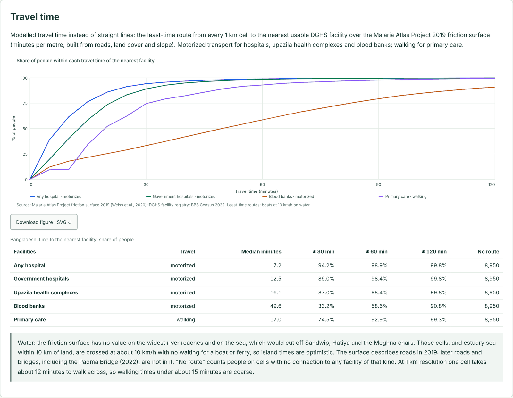
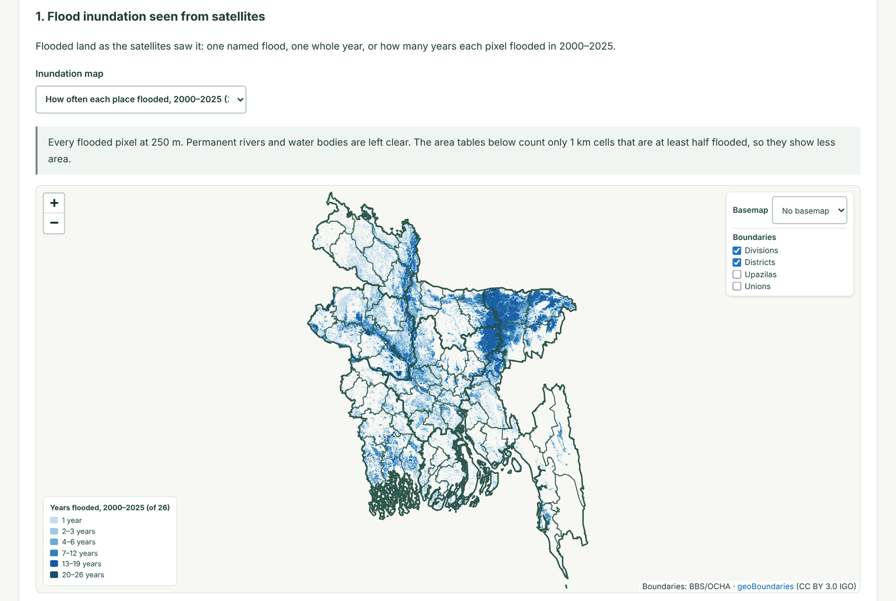
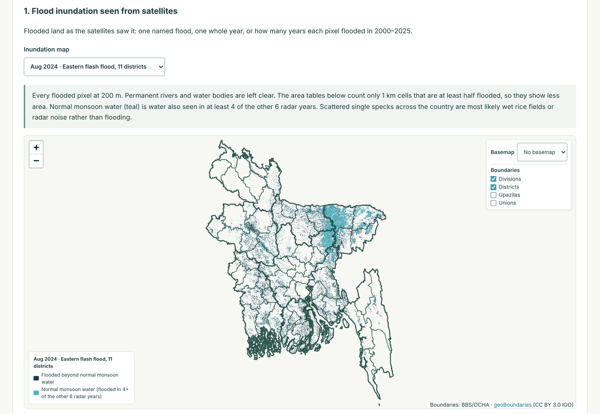
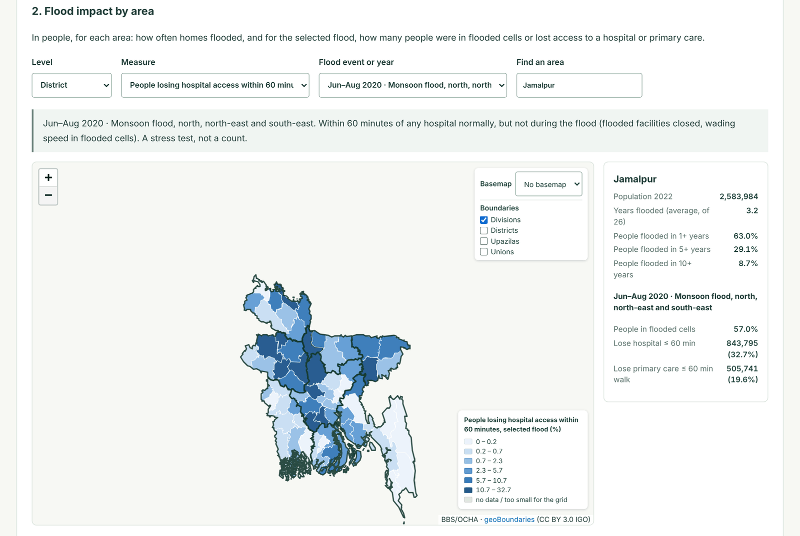
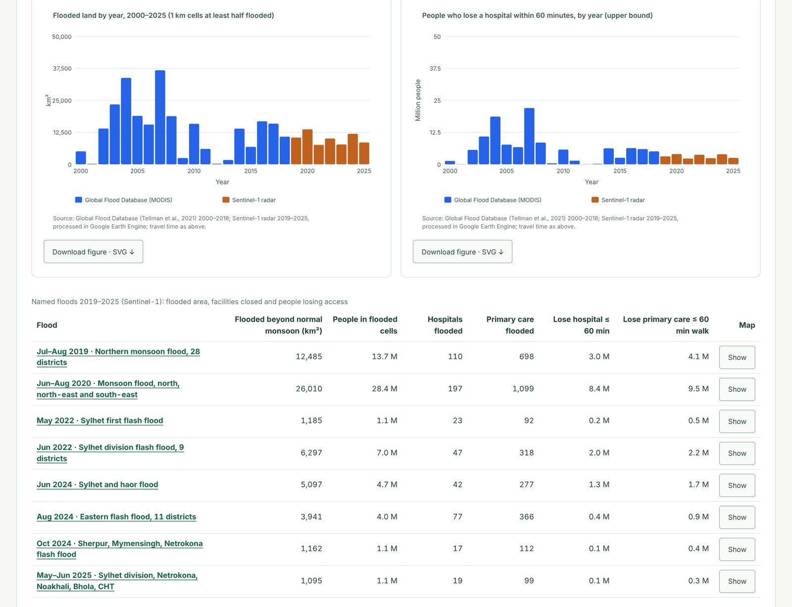
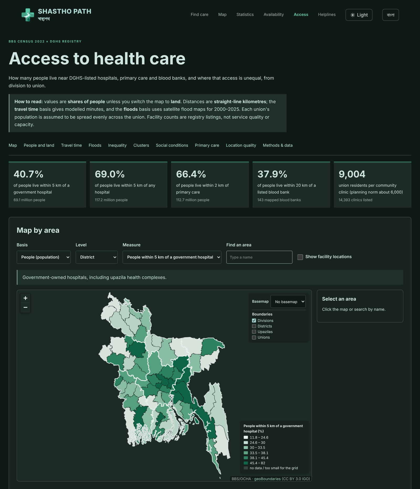

# ShasthoPath · স্বাস্থ্যপথ

A free map and directory for finding healthcare institutions across Bangladesh.

**[Open the website](https://bipul-roy-ai.github.io/Health_care_accessibility/)** ·
**[Map](https://bipul-roy-ai.github.io/Health_care_accessibility/overview.html)** ·
**[Statistics](https://bipul-roy-ai.github.io/Health_care_accessibility/statistics.html)** ·
**[Availability](https://bipul-roy-ai.github.io/Health_care_accessibility/analysis.html)** ·
**[Access](https://bipul-roy-ai.github.io/Health_care_accessibility/accessibility.html)** ·
**[Emergency & helplines](https://bipul-roy-ai.github.io/Health_care_accessibility/helplines.html)**

## What you can find

- Search institutions by name, DGHS code, district or other recorded details.
- View map points and institution information: type, ownership, address, contact
  details, beds and services where recorded, with a link to the official profile.
- Explore all eight divisions with administrative boundaries, boundary-checked points,
  a point legend and division-by-division institution counts.
- Choose a starting point and a facility to see a driving route, road distance,
  estimated time and directions.
- Switch between street and free light-style maps, and show open road/building layers.
- Find national emergency and helpline contacts with tap-to-call links and source references.
- Explore hospital, private-clinic and blood-bank statistics; compare eight divisions per 100,000 residents, inspect published beds and staffing, and download CSV. Sources and simple explanations are on the separate Statistics page.
- Study access to care from division to union with the BBS Census 2022: straight-line distance, modelled travel time, inequality and clusters (the **Access** page).
- See how floods from 2000 to 2025 affected access: satellite inundation maps of eight named floods and every year, how often each place floods, and who loses a hospital or primary care within an hour.
- Use every page in English or Bangla, and in light or dark mode.

## Website screenshots

Screenshots from the Access study: travel time and floods.

**Travel time by upazila.** Average minutes by vehicle to the nearest hospital; the slowest upazilas include the Chittagong Hill Tracts and the haor basin.

**Travel time nationally.** Share of people within each travel time of the nearest facility, with the median and the shares within 30, 60 and 120 minutes.

**Flood inundation, 2000–2025.** How many of the 26 yearly satellite flood maps covered each place (Global Flood Database 2000–2018, Sentinel-1 2019–2025). The haor basin, the Jamuna corridor and Chalan Beel flood most often.

**One named flood.** The August 2024 eastern flash flood from Sentinel-1 radar: flooding beyond normal monsoon water (navy) is shown separately from water that returns most monsoons (teal).

**Flood impact by area.** People who lose a hospital within 60 minutes during the June–August 2020 flood, by district, with the detail for Jamalpur.

**Floods year by year and the named floods.** Flooded land and access losses for every year, and the eight named floods of 2019–2025.

**Dark mode.** Every page has a light/dark switch.

## Information and sources

Statistics use the adjusted **2022 census population** as a baseline. Facility availability is not the same as travel-time access or quality of care. See [sources, definitions and reproducibility](docs/STATISTICS.md).

The initial DGHS directory contains **39,442 institutions** and **62 public report
fields** per record. **28,464** records currently pass the Bangladesh national-boundary check.
**915** outside-boundary coordinates are withheld from maps and routes; their
original values and all institution records remain available for review. Another
10,061 records have missing coordinates and 2 have invalid coordinates. Complete detailed-profile
snapshots are being added in daily batches.

Institution records come from the **[DGHS Facility Registry](https://hrm.dghs.gov.bd/index.php/public/facility-registry)**.
Nearby community-mapped facilities, roads, buildings and basemaps use
**[OpenStreetMap](https://www.openstreetmap.org/copyright)**. Division boundaries
come from **geoBoundaries (CC0)**. The national boundary is from
**OpenStreetMap (ODbL)** and includes offshore islands. Driving routes use **OSRM**.

**[All extracted data and source information are in this repository](data/README.md).**
The site shows snapshot dates and distinguishes missing information. Check current
services and entrances with the institution before travelling.

## Light and dark mode

Every page has a light/dark button next to the language button. The site follows the device setting until a visitor chooses, and the choice is remembered (`theme.js`). Dark colours come from `dark.css`, which `scripts/build_dark_css.py` generates from the other stylesheets (CI checks it is up to date). Charts switch through CSS variables, and downloaded figures keep the light colours.

## DGHS accessibility study

The [Access study page](accessibility.html) combines the **BBS Population and Housing Census 2022** (union/ward tables, adjusted to the BBS post-enumeration-check division totals) with the DGHS registry. From division to union it shows the share of people within 2, 5, 10 and 20 km (straight line) of government hospitals, any hospital, primary care, upazila health complexes and blood banks; facilities and beds per person; population-weighted Gini coefficients and Lorenz curves; Moran's I and local cluster (LISA) maps; correlations with census literacy, sanitation, internet use and indigenous population; and community clinics and union centres against the government's planning norms. It also models **travel time** (Malaria Atlas Project 2019 friction surface, least-time routes, boats on rivers and the estuary) and **flood-disrupted access** from satellite flood maps for 2000–2025 (Global Flood Database 2000–2018, Sentinel-1 2019–2025, eight named floods), produced by the Earth Engine script `scripts/gee/bangladesh_access_inputs.js`. The flood map can overlay the satellite flood maps themselves (`scripts/build_flood_overlays.py`). The map has a basemap switcher, boundary outlines and an optional facility overlay. See [methods](docs/ACCESS_STUDY.md).

**Results at a glance** (model results from the November 2026 build; see the methods for assumptions):

| Measure | Result |
|---|---|
| People within 5 km (straight line) of a government hospital | 40.7% (69.1 million) |
| Median travel time to any hospital, by vehicle | 7.2 minutes; 98.9% within an hour |
| People within 60 minutes of a listed blood bank, by vehicle | 58.6% |
| Median walking time to primary care | 17.0 minutes; 92.9% within an hour |
| People whose 1 km cell flooded in at least 1 / 5 / 10 of the 26 yearly maps, 2000–2025 | 34.7% / 12.8% / 6.7% |
| June–August 2020 flood: people losing a hospital within 60 minutes (stress test) | 8.4 million |

Flood losses assume people wade at about 1.5 km/h through flooded cells, with no boats or raised roads, so they show where the network is fragile rather than counting people cut off. The two satellite eras (MODIS 2000–2018, Sentinel-1 2019–2025) are not directly comparable.

The [offline analysis pipeline](docs/ACCESSIBILITY.md) prepares least-cost travel-time surfaces, reachable-facility counts, capacity-constrained population allocation, referral paths, administrative coverage tables/maps and candidate-site optimization. It has synthetic validation. Bangladesh travel-time coverage from this pipeline (its own transport inputs) has not been computed; the Access page's travel-time results use the Malaria Atlas Project friction surface instead. New health inputs must be DGHS-sourced. The approved population source is BBS. Actual spatial population inputs are still needed, and OSM/open transport support is approved, with provenance and speed assumptions recorded; the actual study layers and boundary files are still required. Community clinics and other tiers remain separate, with division/district/upazila filters.

The supplied boundaries now provide 64 districts and 544 ADM3 upazila/thana areas, with country/division derivatives. The archive named `Bd_union.zip` is not a union layer; true ADM4 boundaries are still needed. See [boundary validation](docs/BOUNDARY_INPUTS.md). Aligned BBS target population/travel grids and DGHS persons-per-period capacity are also still needed for the corresponding analyses. Bed counts cannot be substituted. Missing union-level facility coordinates are a major bias risk. See [input templates and limitations](docs/ACCESSIBILITY.md).

## Future work

- Identify potential locations for new healthcare centres using population needs,
  existing services and travel times.
- Highlight underserved settlements and compare access across rural and urban areas.
- Improve missing or inaccurate coordinates and verify facility entrances.
- Add richer capacity, specialty and accessibility information as it becomes available.

Population-based site recommendations are planned; the current website does not
calculate or approve proposed healthcare locations.

[Development, testing and daily data updates](DEVELOPMENT.md)

## Analysis page

The separate [Analysis page](analysis.html) presents the completed DGHS/BBS availability baseline: 10 administrative-area maps, six-tier national figures, area CSV downloads and coordinate-quality findings. It uses saved results without fetching the current registry or external map tiles. Population access and travel-time results are on the [Access page](accessibility.html). See [baseline methods](docs/AVAILABILITY_BASELINE.md).

The statistical pages now use responsive SVG figures with labelled axes and SVG downloads. The Analysis page adds care-tier counts, coordinate-completeness comparisons, division/district/ADM3 rankings and a count-versus-completeness scatter plot. Its five advanced-analysis modules expose the actual input-readiness report; no travel, coverage, referral or site-selection result is simulated. The selected motorised scenario reports 30, 60 and 120 minute thresholds. Union/ADM4 remains unavailable because the supplied archive is ADM3.

## Distance and location quality

The former Distance page is now part of the [Access page](accessibility.html) (`atlas.html` redirects there). Its map has a **Basis** switch: *People* (default, BBS Census 2022) or *Land*, which shows the original area-based measures from the 1 km grid (median km and share of land within a distance, facilities per km²). A *People versus land* chart compares the two: for example, 40.7% of people but 24.9% of land lie within 5 km of a government hospital.

The atlas build also audits facility coordinates: a point is used only if it lies within 1 km of its recorded district and is not shared with facilities recorded in other areas. Flagged points (listed in `data/atlas/flagged-locations.csv`) are hidden on every map and excluded from distances, but stay in all counts. The audit is summarised in the Access page's *Location data quality* section. See [distance methods](docs/DISTANCE_ATLAS.md) and [access methods](docs/ACCESS_STUDY.md).

## Languages

Every page has an English / বাংলা switch. The choice is remembered across pages (`i18n.js`). Bangla text sits beside the English in `data-bn` attributes; corrections are welcome. DGHS facility, type and upazila/union names stay as published by DGHS and BBS.
