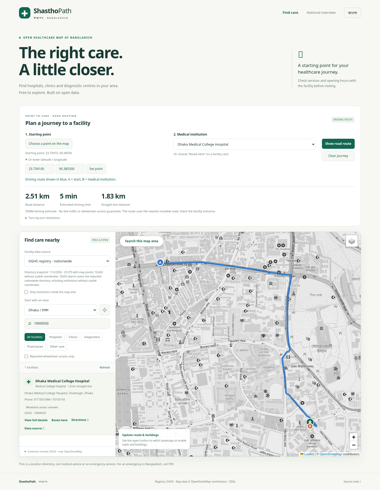
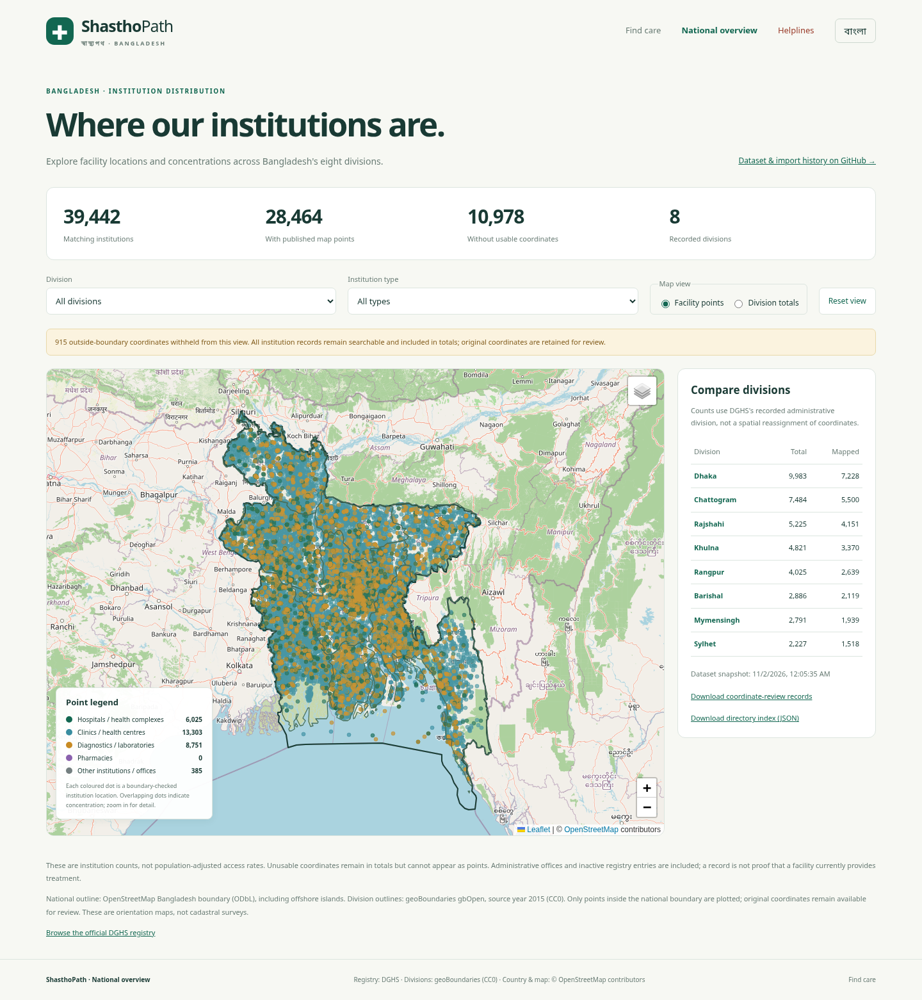
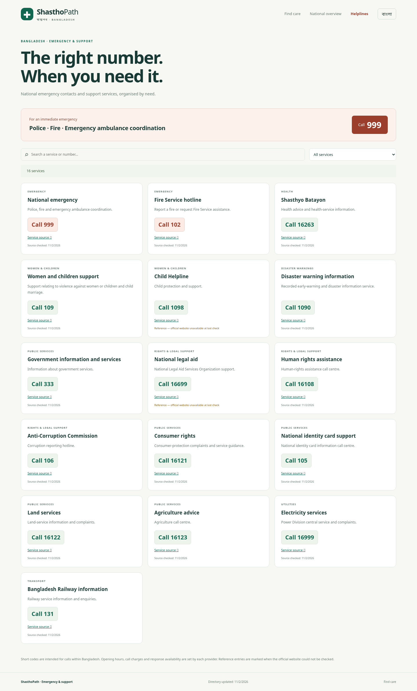
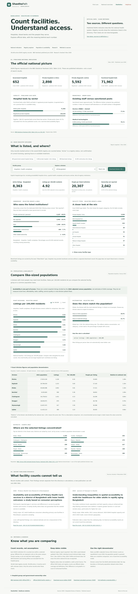

# ShasthoPath · স্বাস্থ্যপথ

A free map and directory for finding healthcare institutions across Bangladesh.

**[Open the website](https://bipul-roy-ai.github.io/Health_care_accessibility/)** ·
**[National overview map](https://bipul-roy-ai.github.io/Health_care_accessibility/overview.html)** ·
**[Healthcare statistics](https://bipul-roy-ai.github.io/Health_care_accessibility/statistics.html)** ·
**[Emergency & helplines](https://bipul-roy-ai.github.io/Health_care_accessibility/helplines.html)**

## What you can find

- Search institutions by name, DGHS code, district or other recorded details.
- View map points and institution information: type, ownership, address, contact
  details, beds and services where recorded, with a link to the official profile.
- Explore all eight divisions with administrative boundaries, boundary-checked points,
  a point legend and division-by-division institution counts.
- Choose a starting point and a facility to see a driving route, road distance,
  estimated time and directions.
- Switch between street and free light-style maps, and show open road/building layers.
- Find national emergency and helpline contacts with tap-to-call links and source references.
- Explore hospital, private-clinic and blood-bank statistics; compare eight divisions per 100,000 residents, inspect published beds and staffing, and download CSV. Sources and simple explanations are on the separate Statistics page.
- Use English or Bangla for the directory, overview and helplines; Statistics is currently in English.

## Website screenshots

Statistics use the adjusted **2022 census population** as a baseline. Facility availability is not the same as travel-time access or quality of care. See [sources, definitions and reproducibility](docs/STATISTICS.md).

## Information and sources

The initial DGHS directory contains **39,442 institutions** and **62 public report
fields** per record. **28,464** records currently pass the Bangladesh national-boundary check.
**915** outside-boundary coordinates are withheld from maps and routes; their
original values and all institution records remain available for review. Another
10,061 records have missing coordinates and 2 have invalid coordinates. Complete detailed-profile
snapshots are being added in daily batches.

Institution records come from the **[DGHS Facility Registry](https://hrm.dghs.gov.bd/index.php/public/facility-registry)**.
Nearby community-mapped facilities, roads, buildings and basemaps use
**[OpenStreetMap](https://www.openstreetmap.org/copyright)**. Division boundaries
come from **geoBoundaries (CC0)**. The national boundary is from
**OpenStreetMap (ODbL)** and includes offshore islands. Driving routes use **OSRM**.

**[All extracted data and source information are in this repository](data/README.md).**
The site shows snapshot dates and distinguishes missing information. Check current
services and entrances with the institution before travelling.

## DGHS accessibility study

A new [Accessibility study page](accessibility.html) separates DGHS primary-care tiers and maps usable institution coordinates without adding outside facilities, population estimates, route calls or new basemap data. It distinguishes facility counts from population access.

The [offline analysis pipeline](docs/ACCESSIBILITY.md) prepares least-cost travel-time surfaces, reachable-facility counts, capacity-constrained population allocation, referral paths, administrative coverage tables/maps and candidate-site optimization. It has synthetic validation; **Bangladesh travel/population coverage has not been computed** because the required approved inputs are not yet supplied. New health inputs must be DGHS-sourced. The approved population source is BBS. Actual spatial population inputs are still needed, and boundary/transport sources require explicit approval. Community clinics and other tiers remain separate, with division/district/upazila filters.

Please supply the requested division/district/union polygons, aligned target population/travel grids and, for capacity analysis, a DGHS persons-per-period service-capacity measure. Bed counts cannot be substituted. Missing union-level facility coordinates are a major bias risk. See [input templates and limitations](docs/ACCESSIBILITY.md).

## Future work

- Identify potential locations for new healthcare centres using population needs,
  existing services and travel times.
- Highlight underserved settlements and compare access across rural and urban areas.
- Improve missing or inaccurate coordinates and verify facility entrances.
- Add richer capacity, specialty and accessibility information as it becomes available.

Population-based site recommendations are planned; the current website does not
calculate or approve proposed healthcare locations.

[Development, testing and daily data updates](DEVELOPMENT.md)
