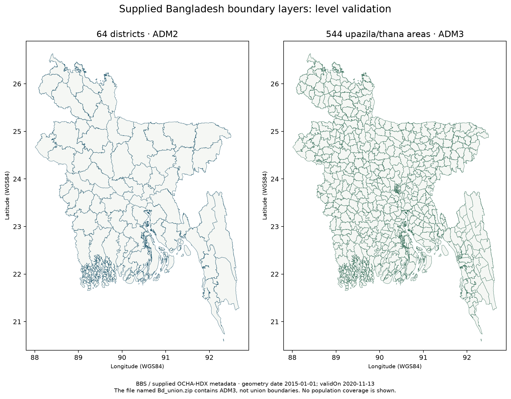

# Supplied administrative boundaries

## Verified inputs

| Uploaded file | Actual level detected | Features | Stable ID | CRS |
|---|---|---:|---|---|
| `Bd_District.zip` | ADM2: district | 64 | `ADM2_PCODE` | EPSG:4326 |
| `Bd_union.zip` | **ADM3: upazila/thana, not union** | 544 | `ADM3_PCODE` | EPSG:4326 |

The second archive has `ADM3_EN`/`ADM3_PCODE`, no ADM4 fields, and its embedded metadata explicitly describes “Bangladesh administrative level 3 (upazila) boundaries.” It includes urban thana names such as Adabor. There are 527 distinct ADM3 names for 544 unique codes, so names alone must not be used as unique keys. The ZIP filename is retained as provenance; it does not override the schema.

Source XML identifies Bangladesh Bureau of Statistics (BBS), ITOS–University of Georgia, and UNOCHA–HumanitarianResponse.info. Both layers record geometry date **1 January 2015** and `validOn` **13 November 2020**. These are not 2026-vintage boundaries. Supplied COD/FOD terms must be retained; no CC0/ODbL licence is inferred for this boundary data.



This figure shows the supplied geometries only. It is not a population coverage, service capacity or travel-time result.

## Checks completed

- All 64 district and 544 ADM3 codes are nonempty and unique.
- All geometries are valid, nonempty Polygon/MultiPolygon features. No automatic geometry repair was needed or performed.
- No within-level polygon overlaps above the diagnostic tolerance of **1 m²** were detected using a metric equal-area projection. The source remains WGS84; `Shape_Area` and `Shape_Leng` are not treated as km²/metres.
- Country code is `BD`; parent code prefixes are consistent.
- All 64 ADM3 parent-district codes match the supplied districts, and parent names agree.
- Dissolving ADM3 areas by district yields no parent/child differences above 1 m². This geometric check does not establish suitability for every later census vintage.

Detailed source hashes and audits: [`data/accessibility/boundaries.json`](../data/accessibility/boundaries.json) and [`boundary-audits/`](../data/accessibility/boundary-audits/). Administrative ID CSVs are included without publishing raw geometry or XML process histories.

## Prepared local layers

The exact supplied raw sidecars remain unchanged under ignored `analysis-inputs/`. Prepared GeoPackages are:

- `analysis-inputs/boundaries/district/district.gpkg`
- `analysis-inputs/boundaries/upazila/upazila_thana.gpkg`
- `analysis-inputs/boundaries/district/derived_division.gpkg`: **8 divisions**, dissolved from the district source.
- `analysis-inputs/boundaries/district/derived_country.gpkg`: **1 country feature**, dissolved from the district source.

The last two are derived from the supplied districts, **not independently supplied official ADM0/ADM1 layers**. They preserve the district dataset's vintage/footprint. They do not silently replace the existing website's country boundary, coordinate QA or original DGHS labels.

The example study configuration now references division, district and upazila/thana layers with their actual IDs. **Union remains missing.** A true union layer must be validated at ADM4 or with its independently documented union-level ID schema before union-level reporting is enabled.

## Reproduce preparation from your local ZIPs

```bash
python -m pip install -r scripts/requirements-geospatial.txt
python scripts/prepare_study_boundaries.py --archive /path/to/Bd_District.zip --output analysis-inputs/boundaries/district --derive-parents
python scripts/prepare_study_boundaries.py --archive /path/to/Bd_union.zip --output analysis-inputs/boundaries/upazila
```

The validation figure can be reproduced with:

```bash
python scripts/plot_boundary_validation.py --district analysis-inputs/boundaries/district/district.gpkg --adm3 analysis-inputs/boundaries/upazila/upazila_thana.gpkg --output docs/images/administrative-boundary-validation.png
```

Choose fresh preparation folders when replacing a source; existing prepared GeoPackages are not overwritten. Only GIS sidecars are extracted. Unsafe archive paths/symlinks, missing sidecars, invalid geometry, duplicate IDs, parent-prefix conflicts and substantive overlaps fail validation. Any non-GIS instructions inside an archive are not installed or executed.

Input ZIPs and prepared GeoPackages are not committed automatically. A new checkout needs these preparation steps before running the configured analysis. The committed audits describe the exact uploads inspected in this cloud session; a GeoPackage may have different container timestamps after regeneration, so raw source hashes are the stable acquisition reference.

## What is still needed

- True **union/ADM4** boundaries and their source/vintage/IDs.
- BBS target-population spatial data or suitable small-area counts with matching codes/year. No fine grid is inferred from division totals.
- The approved open/OSM travel-cost inputs and documented transport mode, season/speeds and barriers.
- DGHS persons-per-period service capacity for capacity-constrained coverage. Bed counts do not substitute.

Old/new district spellings (e.g. Barisal/Barishal, Chittagong/Chattogram) must be resolved through an explicit reviewed crosswalk while retaining source names. This ingestion step does not silently rename districts, geocode missing facilities, reassign DGHS institutions or allocate population.
